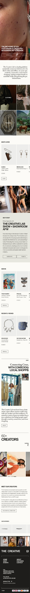
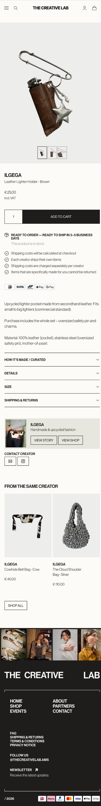
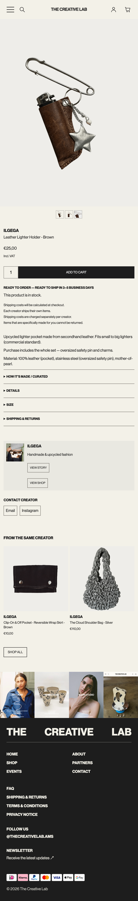

# Procesverslag
Markdown is een simpele manier om HTML te schrijven.  
Markdown cheat cheet: [Hulp bij het schrijven van Markdown](https://github.com/adam-p/markdown-here/wiki/Markdown-Cheatsheet).

Nb. De standaardstructuur en de spartaanse opmaak van de README.md zijn helemaal prima. Het gaat om de inhoud van je procesverslag. Besteedt de tijd voor pracht en praal aan je website.

Nb. Door *open* toe te voegen aan een *details* element kun je deze standaard open zetten. Fijn om dat steeds voor de relevante stuk(ken) te doen.

## Jij

  
uitwerken voor kick-off werkgroep

  ### Auteur:
  Aminata Laureys 

  #### Je startniveau:
  Blauw & Rood

  #### Je focus:
  Responsive
 

## Je website

  
uitwerken voor kick-off werkgroep

  ### Je opdracht:
  <link href= https://thecreativelab.shop>

  #### Screenshot(s) van de eerste pagina (small screen): 
  Home pagina 
  
  Home pagina desktop
  

  #### Screenshot(s) van de tweede pagina (small screen):
  Product pagina
  
  Product pagina desktop
  

## Toegankelijkheidstest 1/2 (week 1)

  
uitwerken na test in 2e werkgroep

### Bevindingen
Lijst met je bevindingen die in de test naar voren kwamen:

Mobile & Touch
Bij het testen van de mobiele weergave viel op dat wanneer de horizontale scroll wordt verwijderd, het menu en het logo over elkaar heen kunnen komen. Hierdoor kan de navigatie minder goed zichtbaar en bruikbaar zijn.

Headings
Sommige koppen op de website, zoals “Next Event” en “Our Story”, zijn niet als echte heading-elementen (h1, h2, etc.) opgebouwd. Hierdoor kan de structuur van de pagina minder duidelijk zijn voor gebruikers die bijvoorbeeld met een screenreader navigeren.

Media
De video helemaal bovenaan de homepage staat automatisch op loop en kan niet handmatig worden gepauzeerd. Ook lijkt de video geen captions te hebben. Dit kan een probleem zijn voor gebruikers die de bewegende content niet goed kunnen waarnemen of de informatie uit de video nodig hebben.

Appearance
De website biedt weinig mogelijkheden om de weergave aan te passen. Er zijn bijvoorbeeld geen instellingen om de tekstgrootte, kleuren of andere visuele eigenschappen aan te passen.

Color Contrast
Over het algemeen is het contrast goed, maar bij de video bovenaan de homepage kan de tekst soms moeilijk leesbaar zijn. Wanneer er lichte beelden achter de tekst verschijnen, is er onvoldoende contrast tussen de tekst en de achtergrond.

Wat ik hiermee doe in mijn eigen versie

Menu en logo overlappen: Het menu is een eigen paneel over de volle breedte (header > nav) en de logo's, iconen en hamburger hebben vaste posities. Vanaf 900px staan de links gewoon in de balk.

Koppen zijn geen headings:	Alle sectietitels zijn echte h1, h2 of h3. De titel bij de categorieën staat visueel verborgen maar blijft voor schermlezers.

Video niet te pauzeren:	In script.js komt een knop "Pause video" op de hero. De video start gepauzeerd als iemand prefers-reduced-motion aan heeft staan.

Contrast bij de video:	Een sterker donker verloop onder de tekst en een lichte tekstschaduw.

Weinig weergaveopties:	Niet opgelost, buiten scope. De site gebruikt wel relatieve eenheden en schaalt mee.
 

## Breakdownschets (week 1)

  
uitwerken na afloop 3e werkgroep

  ### de hele pagina:
  Hier is de link van mijn breakdown schetsen: https://www.figma.com/design/0MrTzvoOTouaeSUABtJn3K/Breakdownschetsen?node-id=0-1&t=mEzAEmNHwPPbaNIK-1 
   

  ### dynamisch deel (bijv menu): 
  Het menu op mobiel: de hamburger wordt een kruisje, het paneel schuift van boven naar beneden en de links komen een voor een binnen.

  

  
  
  

  ### wellicht nog een dynamisch deel (bijv filter): 
  De carousels bij "Most loved", "New in" en "60+ creators": je kunt ze slepen met de muis, scrollen met touch en bedienen met de pijltjestoetsen.

  

 

## Voortgang 1 (week 2)

  
uitwerken voor 1e voortgang

  ### Stand van zaken
  hier dit ging goed & dit was lastig (neem ook screenshots op van delen van je website en code)

  Dit ging goed:
  De opbouw van beide pagina's in semantische HTML.
  De gemeenschappelijke basis in css: kleuren en lettertypes als variabelen (:root), header, footer en de scroll-animatie.

  Alles stylen zonder classes: ik selecteer secties op volgorde (main > section:nth-child(4)). Als de volgorde in de HTML verandert, moeten de nummers in de CSS en JS mee.
  De header opbouwen in JavaScript (logo, iconen, hamburger) zonder div's.

  ### Agenda voor meeting
  samen met je groepje opstellen: ik was ziek en kon er niet bij zijn

  | student 1      | student 2          | student 3    | student 4        |
  | ---            | ---                | ---          | ---              |
  | dit bespreken  | en dit             | en ik dit    | en dan ik dat    |
  | en dat ook nog | dit als er tijd is | nog een punt | dit wil ik zeker |
  | ...            | ...                | ...          | ...              |

  ### Verslag van meeting
  hier na afloop snel de uitkomsten van de meeting vastleggen

  - punt 1
  - punt 2
  - nog een punt
  - ...

 

## Voortgang 2 (week 3)

  
uitwerken voor 2e voortgang

  ### Stand van zaken
  hier dit ging goed & dit was lastig (neem ook screenshots op van delen van je website en code)

  Dit ging goed:
  Carousels met slepen, touch en toetsenbord.
  Alle animaties staan uit bij prefers-reduced-motion.
 
  Dit was lastig:
  Slepen en klikken in één carousel: het slepen begint pas na 5px bewegen, zodat een gewone klik op een product nog werkt.

  ### Agenda voor meeting
  samen met je groepje opstellen: hier was ik wel bij maar we gingen niet over elkaar werk praten, dus ik weet niet precies wat ik hier bij kan zetten.

  | student 1      | student 2          | student 3    | student 4        |
  | ---            | ---                | ---          | ---              |
  | dit bespreken  | en dit             | en ik dit    | en dan ik dat    |
  | en dat ook nog | dit als er tijd is | nog een punt | dit wil ik zeker |
  | ...            | ...                | ...          | ...              |

  ### Verslag van meeting
  hier na afloop snel de uitkomsten van de meeting vastleggen

  - punt 1
  - punt 2
  - nog een punt
- ...

## Toegankelijkheidstest 2/2 (week 4)

  
uitwerken na test in 9e werkgroep

  ### Bevindingen
  Lijst met je bevindingen die in de test naar voren kwamen (geef ook aan wat er verbeterd is):

  Verbeterd sinds de eerste test
  -Video kan gepauzeerd worden en start gepauzeerd bij prefers-reduced-motion.
  -Betere leesbaarheid van de hero-tekst (donkerder verloop, tekstschaduw).
  -Donkerder grijs voor secundaire tekst (#6b6b6b) voor beter contrast.
  -Knoppen en thumbnails zijn minimaal 44px (aantikken), de kleinste tekst is van 9–10px naar 11–12px gegaan.
  -Zichtbare focus-stijlen voor links, knoppen, summary en invoervelden.
  -Een afbeelding met betaalmethodes heeft een alt-tekst, decoratieve foto's in de footer hebben een lege alt.

## Voortgang 3 (week 4)

  
uitwerken voor 3e voortgang

  ### Stand van zaken
  hier dit ging goed & dit was lastig (neem ook screenshots op van delen van je website en code)

  Dit ging goed:
  De website werkt nu op telefoon, tablet en desktop. De basis is mobile-first, met breakpoints op 700px, 900px en 1100px.
  Op desktop komt het ontwerp overeen met de live site: vier categorieën naast elkaar, grijze productvlakken, het event als twee helften en de footer met betaalmethodes.

  Dit was lastig:
  Wat lastig was om het precies te maken als het voorbeeld want de website kan de hele ijd veranderen van verschillende onderwerpen.
  En 5 animaties te maken want er waren maar een paar dingen dat genanimeerd kon maken dus ik heb besloten om het responsive toch te maken.

  ### Agenda voor meeting
  samen met je groepje opstellen

  | student 1      | student 2          | student 3    | student 4        |
  | ---            | ---                | ---          | ---              |
  | dit bespreken  | en dit             | en ik dit    | en dan ik dat    |
  | en dat ook nog | dit als er tijd is | nog een punt | dit wil ik zeker |
  | ...            | ...                | ...          | ...              |

  ### Verslag van meeting
  hier na afloop snel de uitkomsten van de meeting vastleggen

  - punt 1
  - punt 2
  - nog een punt
  - ...

## Eindgesprek (week 5)

  
uitwerken voor eindgesprek

  ### Je uitkomst - karakteristiek screenshots:
  
  

  
  

  ### Dit ging goed/Heb ik geleerd: 
Korte omschrijving met plaatjes

Ik heb geleerd om mijn HTML op te bouwen zonder 
-elementen en class-attributen. Hierdoor moest ik bewuster nadenken over de semantische structuur van mijn website.

Ik begrijp nu beter hoe ik CSS-variabelen en clamp() kan gebruiken om mijn website responsive te maken.

Ik heb meer ervaring opgedaan met JavaScript, vooral bij het maken van interactieve elementen en animaties.

Ik heb geleerd hoe ik verschillende onderdelen van een website met CSS en JavaScript met elkaar kan laten samenwerken.

Ik heb meer rekening gehouden met toegankelijkheid, bijvoorbeeld door focus, contrast, reduced motion en aantikbare elementen.

Ik heb geleerd om mijn website steeds te testen op verschillende schermformaten en problemen stap voor stap op te lossen.

  
  
  
  

  ### Dit was lastig/Is niet gelukt:
  Korte omschrijving met plaatjes

Het schrijven van JavaScript vond ik soms lastig. Vooral het begrijpen van de verschillende functies en hoe interacties met HTML-elementen samenwerken.

Het responsive maken van de website kostte meer tijd dan verwacht. Sommige onderdelen zagen er op mobiel goed uit, maar moesten op grotere schermen opnieuw worden aangepast.

Het namaken van de originele website was soms lastig, omdat bepaalde elementen en afstanden moeilijk precies over te nemen waren.

Het combineren van animaties met responsive design vroeg extra aandacht. Ik moest ervoor zorgen dat animaties ook goed werken op mobiele apparaten.

Ik moest regelmatig mijn code aanpassen en fouten oplossen voordat alles goed werkte.

   
  
  
  

## Bronnenlijst

  
continu bijhouden terwijl je werkt

  Nb. Wees specifiek ('css-tricks' als bron is bijv. niet specifiek genoeg). 
  Nb. ChatGpT en andere AI horen er ook bij.
  Nb. Vermeld de bronnen ook in je code.

1. The Creative Lab — https://thecreativelab.shop
Gebruikt als voorbeeld voor de layout, teksten en afbeeldingen. De website is nagemaakt met zelfgeschreven HTML, CSS en JavaScript.

2. MDN Web Docs — @font-face — https://developer.mozilla.org/en-US/docs/Web/CSS/Reference/At-rules/@font-face
Gebruikt voor het toevoegen van externe lettertypes aan de website.

3. W3Schools — CSS clamp() Function — https://www.w3schools.com/cssref/func_clamp.php
Gebruikt voor het schaalbaar maken van onder andere de hoogtes en lettergroottes.

4. W3Schools — CSS Media Queries — https://www.w3schools.com/css/css_rwd_mediaqueries.asp
Gebruikt als ondersteuning bij het responsive maken van de website voor verschillende schermformaten.

5. MDN Web Docs — addEventListener() — https://developer.mozilla.org/en-US/docs/Web/API/EventTarget/addEventListener
Gebruikt als ondersteuning bij JavaScript-interacties, zoals klikacties en toetsenbordbediening.

6. MDN Web Docs — Intersection Observer API — https://developer.mozilla.org/en-US/docs/Web/API/Intersection_Observer_API
Gebruikt als ondersteuning bij de scrollanimaties.

7. ChatGPT (OpenAI)
Gebruikt als ondersteuning bij het schrijven, verbeteren en begrijpen van voornamelijk JavaScript en CSS. Ook gebruikt voor het oplossen van fouten en in beperkte mate voor HTML.

8. Claude (Anthropic)
Gebruikt als aanvullende ondersteuning tijdens het programmeren en het oplossen van codeproblemen.

